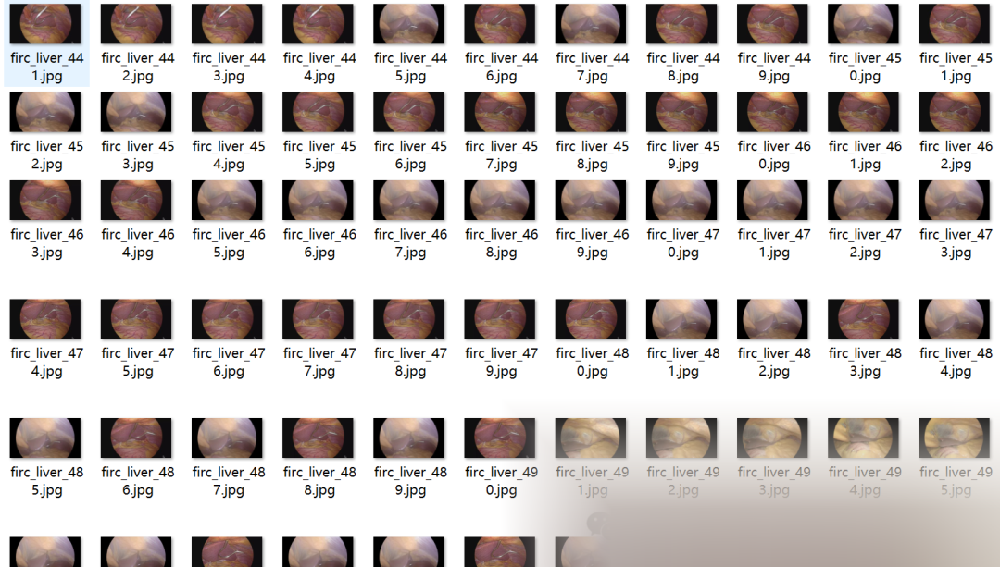
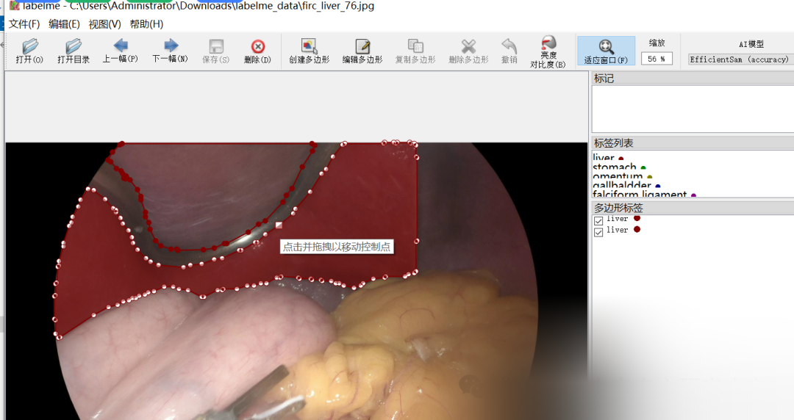

# Medical Image Segmentation Dataset: Abdominal Liver Multi-Organ Image Segmentation Dataset - LabelMe format - 860 images in 10 categories

Dataset format: labelme format (without mask files, only including jpg images and corresponding json files)

Number of images (number of jpg files): 860

Number of annotations (number of json files): 860

Label category count: 10

Annotation category names: ["liver", "stomach", "omentum", "falciform ligament", "diaphragm", "Nathason", "gallbaldder", "port", "Covidien", "soft bowel grasper"]

Number of boxes labeled in each category:

liver count = 1400

stomach count = 160

omentum count = 147

falciform ligament count = 78

diaphragm count = 29

Nathason count = 98

gallbaldder count = 38

port count = 14

covidien count = 3

soft bowel grasper count = 3

Using labeling tool: labelme=5.2.0

Annotation rules: Draw polygons around the categories.

Important Notice: The dataset can be opened and edited using LabelMe, and the JSON dataset can be converted into mask or Yolo format for semantic segmentation or instance segmentation.

Special : This dataset does not guarantee the accuracy or precision of the trained models or weight files. The dataset is provided with accurate and reasonable annotations only.

Image Preview:

Annotation example:

Dataset address:

## Payment

Here is a pay link on Stripe ( https://buy.stripe.com/3cs8yP7sY87d0vu9AB ). Please contact me lonlonago@foxmail.com after funding $89, and I will send you a complete data files , thank you!

